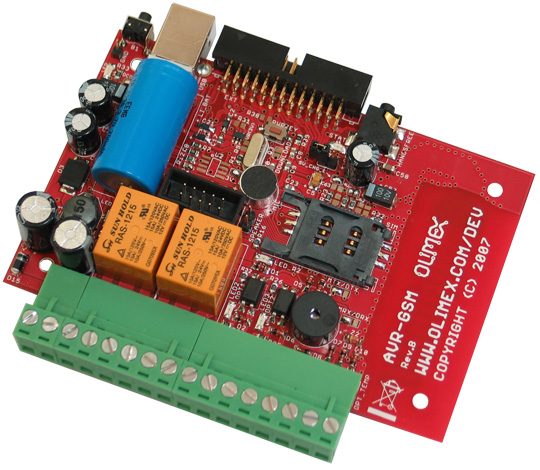

# AVR-GSM-SMS
I bought this development board back around 2013 so I could control our gas boiler at our vacation home on Lake Balaton.
https://www.olimex.com/Products/AVR/Development/AVR-GSM/



I just got it out from a box to update a bit using the ChatGPT Codex with the latest available development tools:

```
$ avr-gcc --version

avr-gcc (GCC) 16.1.0
Copyright (C) 2026 Free Software Foundation, Inc.
This is free software; see the source for copying conditions.  There is NO
warranty; not even for MERCHANTABILITY or FITNESS FOR A PARTICULAR PURPOSE.

$ avrdude --version
Avrdude version 8.2
Copyright see https://github.com/avrdudes/avrdude/blob/main/AUTHORS
Use https://github.com/avrdudes/avrdude/issues to report bugs and ask questions

15:52:17 Tue Sep 08 [flex@flexs-MacBook-Pro-M4:[~/gith/AVR-GSM-SMS] [0]
```
The result turned out to be interesting: it’s **amazing** to me again.

Current status:
- compiles without any errors
- handles SMS text messages better
- has button control
- can use the beeper
- shows GSM status: temp, signal, battery level
- ...

```
$ make

mkdir -p "build"
touch "build/.dir"
avr-gcc -mmcu=atmega32 -I. -Ibuild -DF_CPU=7372800UL -DUART_BAUD_RATE=57600UL -DUART_RX0_BUFFER_SIZE=256 -DUART_TX0_BUFFER_SIZE=64 -Os -g -std=gnu99 -Wall -Wextra -Wstrict-prototypes -Werror -ffunction-sections -fdata-sections -fstack-usage -MMD -MP -MF build/AVR-GSM-SMS.d -c AVR-GSM-SMS.c -o build/AVR-GSM-SMS.o
avr-gcc -mmcu=atmega32 -I. -Ibuild -DF_CPU=7372800UL -DUART_BAUD_RATE=57600UL -DUART_RX0_BUFFER_SIZE=256 -DUART_TX0_BUFFER_SIZE=64 -Os -g -std=gnu99 -Wall -Wextra -Wstrict-prototypes -Werror -ffunction-sections -fdata-sections -fstack-usage -MMD -MP -MF build/gsm.d -c gsm.c -o build/gsm.o
avr-gcc -mmcu=atmega32 -I. -Ibuild -DF_CPU=7372800UL -DUART_BAUD_RATE=57600UL -DUART_RX0_BUFFER_SIZE=256 -DUART_TX0_BUFFER_SIZE=64 -Os -g -std=gnu99 -Wall -Wextra -Wstrict-prototypes -Werror -ffunction-sections -fdata-sections -fstack-usage -MMD -MP -MF build/gsm_services.d -c gsm_services.c -o build/gsm_services.o
avr-gcc -mmcu=atmega32 -I. -Ibuild -DF_CPU=7372800UL -DUART_BAUD_RATE=57600UL -DUART_RX0_BUFFER_SIZE=256 -DUART_TX0_BUFFER_SIZE=64 -Os -g -std=gnu99 -Wall -Wextra -Wstrict-prototypes -Werror -ffunction-sections -fdata-sections -fstack-usage -MMD -MP -MF build/sms_pdu.d -c sms_pdu.c -o build/sms_pdu.o
avr-gcc -mmcu=atmega32 -I. -Ibuild -DF_CPU=7372800UL -DUART_BAUD_RATE=57600UL -DUART_RX0_BUFFER_SIZE=256 -DUART_TX0_BUFFER_SIZE=64 -Os -g -std=gnu99 -Wall -Wextra -Wstrict-prototypes -Werror -ffunction-sections -fdata-sections -fstack-usage -MMD -MP -MF build/application.d -c application.c -o build/application.o
avr-gcc -mmcu=atmega32 -I. -Ibuild -DF_CPU=7372800UL -DUART_BAUD_RATE=57600UL -DUART_RX0_BUFFER_SIZE=256 -DUART_TX0_BUFFER_SIZE=64 -Os -g -std=gnu99 -Wall -Wextra -Wstrict-prototypes -Werror -ffunction-sections -fdata-sections -fstack-usage -MMD -MP -MF build/sensors.d -c sensors.c -o build/sensors.o
avr-gcc -mmcu=atmega32 -I. -Ibuild -DF_CPU=7372800UL -DUART_BAUD_RATE=57600UL -DUART_RX0_BUFFER_SIZE=256 -DUART_TX0_BUFFER_SIZE=64 -Os -g -std=gnu99 -Wall -Wextra -Wstrict-prototypes -Werror -ffunction-sections -fdata-sections -fstack-usage -MMD -MP -MF build/persistence.d -c persistence.c -o build/persistence.o
avr-gcc -mmcu=atmega32 -I. -Ibuild -DF_CPU=7372800UL -DUART_BAUD_RATE=57600UL -DUART_RX0_BUFFER_SIZE=256 -DUART_TX0_BUFFER_SIZE=64 -Os -g -std=gnu99 -Wall -Wextra -Wstrict-prototypes -Werror -ffunction-sections -fdata-sections -fstack-usage -MMD -MP -MF build/runtime.d -c runtime.c -o build/runtime.o
avr-gcc -mmcu=atmega32 -I. -Ibuild -DF_CPU=7372800UL -DUART_BAUD_RATE=57600UL -DUART_RX0_BUFFER_SIZE=256 -DUART_TX0_BUFFER_SIZE=64 -Os -g -std=gnu99 -Wall -Wextra -Wstrict-prototypes -Werror -ffunction-sections -fdata-sections -fstack-usage -MMD -MP -MF build/ui.d -c ui.c -o build/ui.o
avr-gcc -mmcu=atmega32 -I. -Ibuild -DF_CPU=7372800UL -DUART_BAUD_RATE=57600UL -DUART_RX0_BUFFER_SIZE=256 -DUART_TX0_BUFFER_SIZE=64 -Os -g -std=gnu99 -Wall -Wextra -Wstrict-prototypes -Werror -ffunction-sections -fdata-sections -fstack-usage -MMD -MP -MF build/lcd.d -c lcd.c -o build/lcd.o
avr-gcc -mmcu=atmega32 -I. -Ibuild -DF_CPU=7372800UL -DUART_BAUD_RATE=57600UL -DUART_RX0_BUFFER_SIZE=256 -DUART_TX0_BUFFER_SIZE=64 -Os -g -std=gnu99 -Wall -Wextra -Wstrict-prototypes -Werror -ffunction-sections -fdata-sections -fstack-usage -MMD -MP -MF build/uart.d -c uart.c -o build/uart.o
avr-gcc -mmcu=atmega32 -Wl,--gc-sections,-Map=build/AVR-GSM-SMS.map build/AVR-GSM-SMS.o build/gsm.o build/gsm_services.o build/sms_pdu.o build/application.o build/sensors.o build/persistence.o build/runtime.o build/ui.o build/lcd.o build/uart.o  -o build/AVR-GSM-SMS.elf
avr-objcopy -O ihex -R .eeprom build/AVR-GSM-SMS.elf build/AVR-GSM-SMS.hex
avr-objcopy -j .eeprom --set-section-flags=.eeprom=alloc,load --change-section-lma .eeprom=0 --no-change-warnings -O ihex build/AVR-GSM-SMS.elf build/AVR-GSM-SMS.eep
avr-objdump -h -S build/AVR-GSM-SMS.elf > build/AVR-GSM-SMS.lss
avr-nm -n build/AVR-GSM-SMS.elf > build/AVR-GSM-SMS.sym
avr-size build/AVR-GSM-SMS.elf
   text    data     bss     dec     hex filename
  18872       0    1223   20095    4e7f build/AVR-GSM-SMS.elf
python3 tools/check_size.py avr-size build/AVR-GSM-SMS.elf
Flash: 18872/32768 bytes; static SRAM: 1271/2048; stack headroom: 777
```
